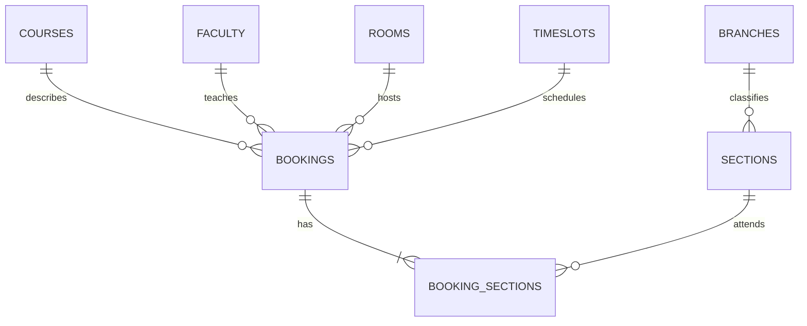

# Database setup and timetable import (Member A)

The JDBC layer implements `BookingSource`, the DAO contract, and the public `SchedulingService.fromJdbc()` entry point. It uses MySQL Connector/J in production and an isolated in-memory H2 database in tests.

## Configure MySQL

1. Create the database once: `CREATE DATABASE scheduler_db CHARACTER SET utf8mb4;`.
2. Set `DB_URL`, `DB_USERNAME`, and `DB_PASSWORD` in the local environment. Defaults are in `src/main/resources/config.properties`; environment variables override them. Do not put real credentials in Git.
3. Create the schema with `DatabaseSetup create`, then import the cleaned CSV with `DatabaseSetup import src/main/resources/data/all_sheets_cleaned.csv`.

With Maven's exec plugin available, run:

```text
mvn -q -Dexec.mainClass=com.university.scheduler.dao.DatabaseSetup -Dexec.args="create" exec:java
mvn -q -Dexec.mainClass=com.university.scheduler.dao.DatabaseSetup -Dexec.args="import src/main/resources/data/all_sheets_cleaned.csv" exec:java
```

To rebuild from an empty database, use `DatabaseSetup reset` (or execute `reset-database.sql`) before importing. **Reset drops all project tables and their data.** Import is one transaction and requires an empty schema; a failed import rolls back completely.

## Load sequence and data rules

The importer parses the cleaned CSV through the existing `CsvBookingSource`, runs the shared conflict checker, then writes lookup rows before sessions: faculty, rooms, courses, sections, time slots, bookings, and booking-to-section links. Slash-separated lists of alternative course codes are skipped and logged because they cannot be represented as one course in the current model. Room and faculty conflicts are rejected by the same engine rules used by CSV mode. A combined class is stored as one booking with multiple `booking_sections` rows.

Rows with unresolved faculty or room identities retain the engine's synthetic identifiers. Their lookup rows are marked `is_synthetic=TRUE`, so they satisfy foreign keys without being presented as confirmed institutional identities. Faculty weekly limits remain the engine's placeholder value (18), room capacity remains the CSV loader's placeholder (150), and room type follows the loader's current default. These are not real policy or capacity data.

Member A confirmed the suffix mapping `L → LECTURE`; `T → TUTORIAL` and `P → PRACTICAL`. The database uses `(course_code, period_type)` as the course key because the source contains many base codes with more than one suffix. The section's year and division are taken from recognizable sheet labels; branch remains null. The timetable owner recommended leaving branch mapping and room types out of scope because room names vary and roughly 30–35 additional files would need manual integration. Period end time is left null because the CSV does not provide it.

The schema deliberately does not make `(section_id, timeslot_id)` unique. The engine's decision analysis found section clashes in the source, and the team's data owner must decide whether those are source errors before strict enforcement. Booking uniqueness on room/time and faculty/time prevents conflicting sessions while allowing a combined session to attend several sections.

## Tables



`schema.sql` is the source for field definitions and constraints. `branches` and `sections` store academic grouping; `faculty` and `rooms` store resources; `courses` distinguishes period types; `timeslots` identifies a weekday and period; `bookings` is one scheduled session; and `booking_sections` is the many-to-many link that retains combined classes. Foreign keys are enabled throughout. `is_synthetic` identifies inferred faculty and room rows.

## DAO and API usage

`FacultyDAO`, `RoomDAO`, `CourseDAO`, `SectionDAO`, and `BookingDAO` expose find, insert, update, and delete operations. `BookingDAO` writes the session and its section links in one transaction. SQL values use `PreparedStatement`; connections are closed with try-with-resources; failures are surfaced as `DatabaseException` and logged by importing/loading layers.

```java
SchedulingService service = SchedulingService.fromJdbc();
```

For tests or another configured data source, pass a `ConnectionProvider` to `SchedulingService.fromJdbc(provider)`. `JdbcBookingSource` can also be passed to `ScheduleLoader` directly. Contract and DAO tests use a unique in-memory H2 database and never touch MySQL.

## Verification and remaining data decisions

Run `mvn test` to run DAO CRUD/failure tests and the shared `BookingSourceContractTest` against both CSV and JDBC. The JDBC contract checks non-null/repeatable loading, complete bookings, and loader acceptance counts. Import results report parsed rows, accepted sessions, section attendances, and conflicts rejected by the engine.

Live MySQL verification on MySQL 8.4.13 imported the cleaned CSV successfully: 6,039 parsed bookings, 5,514 accepted sessions, 5,514 section attendances, and 509 conflicts rejected by the engine. The database contained 5,514 booking rows and 5,514 section links afterward; read-only checks found no room/time or faculty/time duplicates. A CSV-versus-JDBC parity check matched session totals, attendance totals, and every faculty load. The database import was run only after confirming all project tables were empty.

Branch mapping and room-type classification are intentionally deferred per the timetable owner's recommendation. The original Excel workbook and related 30–35 files are not included here, so the importer keeps branch unset and uses the current `CLASSROOM` default instead of inventing mappings. Synthetic IDs remain visible for rows the existing parser cannot confidently resolve.
